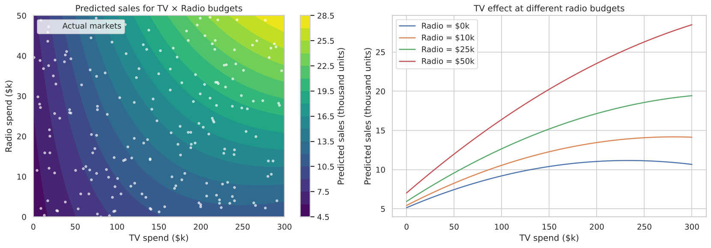
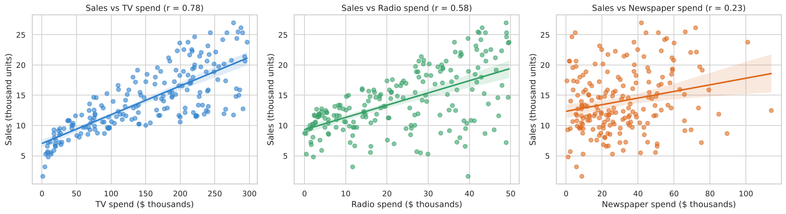
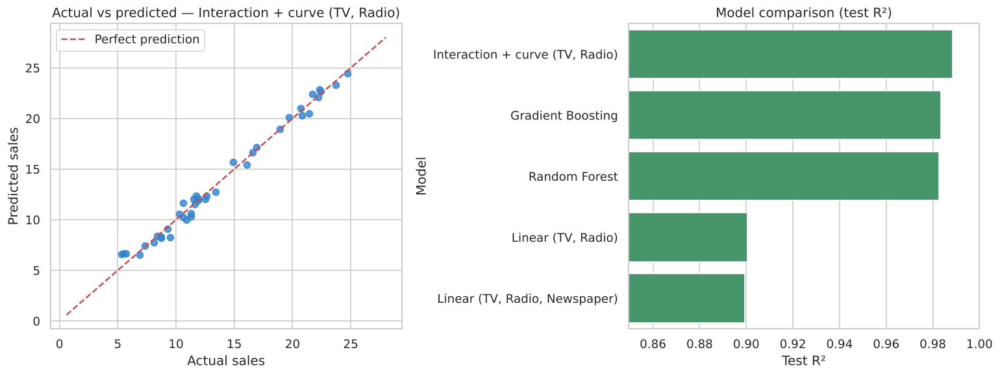

<div align="center">

# 📈 Sales Prediction using Python

**CodeAlpha Data Science Internship · Task 4**

      

A model that predicts product sales from advertising spend on TV, Radio and Newspaper with **R² = 0.99**, and finds a budget split that could raise sales by about **35% at no extra cost**.

</div>

---

## 📑 Table of Contents
- [Overview](#-overview)
- [Dataset](#-dataset)
- [Project Workflow](#-project-workflow)
- [Results](#-results)
- [Key Insights](#-key-insights)
- [Visualizations](#-visualizations)
- [Project Structure](#-project-structure)
- [Getting Started](#-getting-started)
- [Tech Stack](#-tech-stack)
- [Author](#-author)

## 📌 Overview
Businesses spend large amounts on advertising, but which channel actually brings in sales? This project
uses spending data from 200 markets to **predict sales**, measure how much each advertising channel
contributes, and test **what-if budget scenarios** that marketing teams can act on.

## 📂 Dataset
| Property | Value |
|---|---|
| Source | [Advertising dataset on Kaggle](https://www.kaggle.com/datasets/bumba5341/advertisingcsv) |
| Rows | 200 markets |
| Features | `TV`, `Radio`, `Newspaper` (advertising spend in $ thousands) |
| Target | `Sales` (in thousands of units) |

The dataset is included in the [`data/`](data/) folder, so the notebook runs without any extra downloads.

## 🔄 Project Workflow
1. **Data cleaning**: dropped the index column; checked for missing values, duplicates and negative values
2. **EDA**: distributions, sales vs spend on each channel, correlation heatmap
3. **Feature selection**: models with and without `Newspaper` compared using cross-validation
4. **Modelling**: Linear Regression, an **interaction + curve model** (TV × Radio and squared terms), Random Forest and Gradient Boosting
5. **Evaluation**: R², MAE and RMSE on a held-out test set
6. **Business analysis**:
   - Sales uplift from an extra $10k on each channel
   - Budget reallocation with the same total spend
   - A TV × Radio sales map showing how the two channels work together

## 📊 Results
| Model | CV R² | Test R² | Test MAE | Test RMSE |
|---|:---:|:---:|:---:|:---:|
| 🏆 **Interaction + curve (TV, Radio)** | **0.982** | **0.989** | **0.49** | **0.60** |
| Gradient Boosting | 0.968 | 0.984 | 0.60 | 0.72 |
| Random Forest | 0.966 | 0.983 | 0.61 | 0.74 |
| Linear (TV, Radio) | 0.874 | 0.901 | 1.44 | 1.77 |
| Linear (TV, Radio, Newspaper) | 0.870 | 0.899 | 1.46 | 1.78 |

> Models are compared using **5-fold cross-validation** on the training set. The test set is held out until the end for a fair final check.

## 💡 Key Insights
- 📻 **Radio gives the best return:** about **190 extra units per extra $1,000**, compared with about 45 for TV.
- 📰 **Newspaper has almost no effect** on sales. Dropping it does not make the model worse.
- 🤝 **TV and Radio work best together.** Modelling their interaction raised R² from 0.87 to 0.98.
- 📺 **TV has diminishing returns.** Each extra dollar adds less once TV spend is already high.
- 💡 **Moving the newspaper budget to radio** is predicted to raise sales by about **35%** with the same total budget.

**Recommendations:** cut newspaper spend, plan TV and radio campaigns together, watch for TV saturation,
and confirm the changes with A/B tests in a few markets before rolling them out.

## 🖼️ Visualizations
### How TV and Radio work together


### Sales vs spend on each channel


### Model results


More charts are available in the [`images/`](images/) folder and in the notebook.

## 🗂️ Project Structure
```
CodeAlpha_SalesPrediction/
├── Sales_Prediction.ipynb                # Full analysis with code, charts and explanations
├── sales_prediction.py                     # Same analysis as a plain Python script
├── data/                                   # Dataset
├── images/                                 # Saved charts
├── requirements.txt                        # Python dependencies
└── README.md
```

## 🚀 Getting Started

**1. Clone the repository**
```bash
git clone https://github.com/Lohith-L/CodeAlpha_SalesPrediction.git
cd CodeAlpha_SalesPrediction
```

**2. (Optional) Create a virtual environment**
```bash
python -m venv venv
source venv/bin/activate        # Windows: venv\Scripts\activate
```

**3. Install the dependencies**
```bash
pip install -r requirements.txt
```

**4. Open the notebook**
```bash
jupyter notebook Sales_Prediction.ipynb
```
Then choose **Kernel → Restart & Run All**.

Or run the Python script instead:
```bash
python sales_prediction.py
```

## 🛠️ Tech Stack
| Tool | Purpose |
|---|---|
| Python | Programming language |
| Pandas, NumPy | Data cleaning and manipulation |
| Matplotlib, Seaborn | Data visualization |
| Scikit-learn | Machine learning models and evaluation |
| Jupyter Notebook | Interactive analysis |

## 👤 Author

**Lohith L**
BCA Student · Data Science Intern at CodeAlpha

- GitHub: [@Lohith-L](https://github.com/Lohith-L)

## 🙏 Acknowledgements

- [CodeAlpha](https://www.codealpha.tech) for the internship opportunity and project guidance
- [Kaggle](https://www.kaggle.com) for the dataset

---
⭐ If you found this project useful, consider giving it a star!
